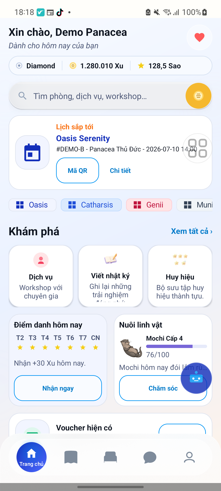

# Panacea Mobile — Android Booking Portfolio

A team coursework project from the **Faculty of Information Systems, University of Economics and Law (UEL)**. Panacea Mobile is a native Android application for exploring rooms and services, making bookings, and reviewing booking history. This repository presents selected contributions and a small set of source files—not the complete group project.

**[View the portfolio page](https://gonovn.me/panacea-mobile-portfolio/)** · **[Open the original app screenshot](assets/panacea-mobile-home.png)**



The image is an actual screenshot of the Android app using a demo account. The portfolio page presents a static screenshot; it is not the app or an interactive Android emulator.

## My contribution

I participated in the booking and booking-history experience, API integration, and local data handling. The project was developed with teammates: the files and screens shown here are shared project work, and a commit touching a file does not imply that one person wrote it in full. Selected Git history attributes a booking date/time validation change to `gonostudy305` (commit `b3bb05f` in the original private repository).

My work covered the following engineering concerns:

- **Booking-time validation:** handle Vietnam business time, date-picker values, and minimum lead time for a booking slot.
- **Booking history and local data:** contribute to the flows that surface a user's bookings and coordinate local data with an API.
- **Resilient cancellation:** work with a cancellation sync path that uses owner-scoped pending requests, a stable request identifier, and retryable failure handling.

These are descriptions of my participation and code present in the team project, not a claim of sole authorship or independently verified production performance.

## Selected code and what it demonstrates

| File | Why it matters |
| --- | --- |
| [DateTimeHelper.java](examples/booking-policy/src/main/java/com/panacea/mobile/utils/DateTimeHelper.java) | Uses `Asia/Ho_Chi_Minh` for business time and converts UTC-midnight date-picker values. Its clock-injected methods make lead-time and timezone boundary cases testable. |
| [BookingSlotPolicyTest.java](examples/booking-policy/src/test/java/com/panacea/mobile/BookingSlotPolicyTest.java) | Tests the 30-minute boundary, end-of-day cutoff, and a Vietnam/UTC date boundary with fixed inputs. |
| [CancellationRequestPolicy.java](examples/booking-policy/src/main/java/com/panacea/mobile/utils/CancellationRequestPolicy.java) | Derives a stable cancellation request key and rejects blank booking IDs. |
| [CancellationRequestPolicyTest.java](examples/booking-policy/src/test/java/com/panacea/mobile/CancellationRequestPolicyTest.java) | Checks key stability and rejection of blank IDs. |
| [BookingSyncManager.java](examples/reference/BookingSyncManager.java) | A reference excerpt showing the cancellation-only sync path, owner-scoped queue, idempotency key, and retry handling. It depends on the original Android app and is not part of the standalone test module. |

The included Java files and original JUnit tests are copied from the group project as a **small curated snapshot**. Dependencies such as the Android UI, original database, backend, authentication, app configuration, and project Git history are not included. The full application cannot be built from this portfolio repository.

### Booking cancellation flow, as shown in the reference excerpt

```text
Authenticated user + network available
        ↓
Find that user's pending cancellation requests
        ↓
Submit cancellation with a stable request key
        ↓
On success: update local sync state
On network error, rate limit, or server failure: retain work for retry
```

Background synchronization in the excerpt is limited to previously approved cancellations. Booking creation and confirmation remain foreground actions; the coursework payment flow was a demo and did not process real money. This diagram summarizes the selected code rather than asserting end-to-end deployment or payment behavior.

## Run the selected policy tests

The `examples/booking-policy` folder is a small, independent Java test module prepared for this portfolio. It includes the original helper classes and JUnit 4 tests; it is not an Android build. Requirements: a JDK, Gradle installed locally, and access to Maven Central for JUnit 4.13.2.

```sh
cd examples/booking-policy
gradle test
```

The full Android or server integration is not included, so these tests cover the selected policy methods only. Known limitation: `bookingDateToUtcMillis` uses a lenient `Calendar`, so invalid calendar dates can normalize to another date; do not treat this helper as strict date validation. This module was prepared for inspection; the tests have **not** been rerun in the current environment because JDK and Gradle commands were unavailable on PATH. No production performance or release claims are made.

## Original project stack

- Android native: Java and XML layouts.
- API integration: Retrofit and OkHttp.
- Local persistence: SQLite.
- Backend context: Node.js/Express and MongoDB (separate team project).

The browser portfolio page uses HTML/CSS and contains no live booking service. The repository does not include customer records, private configuration, or deployment credentials.
